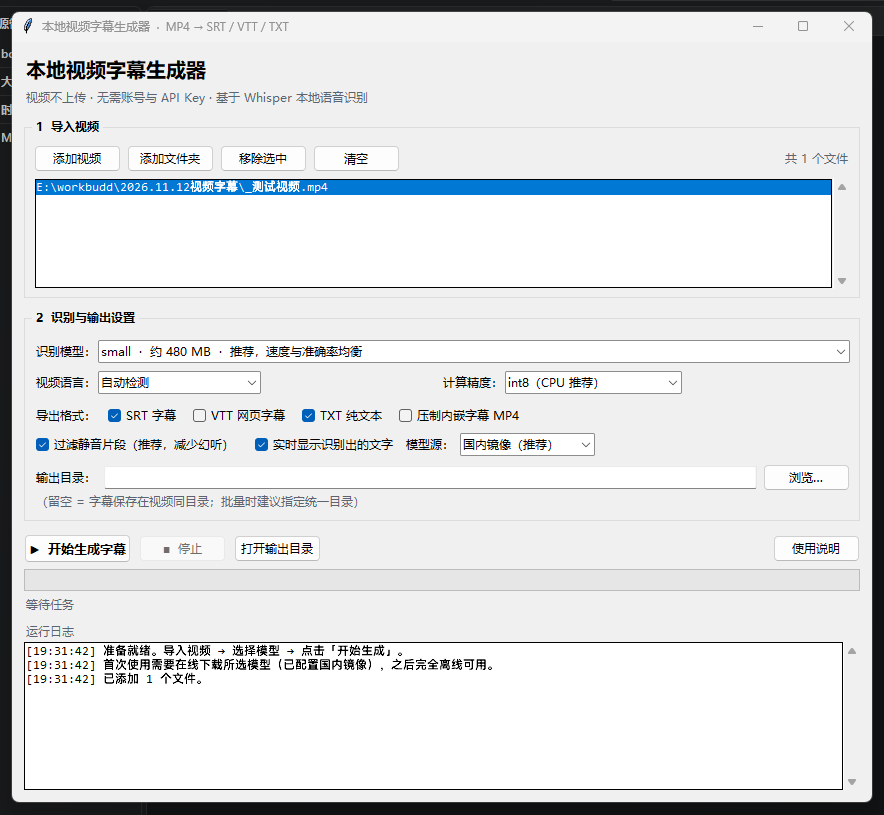

# 本地视频字幕生成器


导入 MP4，一键生成带时间轴的字幕。基于 [faster-whisper](https://github.com/SYSTRAN/faster-whisper)，
**识别全程在本机完成**：视频不上传、不需要账号和 API Key、不花钱，下载一次模型之后可以完全断网使用。

> 这是一个**本地桌面软件**，不是网站。GitHub 在这里用于托管代码和发布可执行文件，
> 不能把它当在线服务跑；GitHub Pages 只适合放项目介绍页。



---

## ✨ 特性

- 🎬 支持 MP4 / MOV / MKV / AVI / WebM 等常见视频，也支持 WAV / MP3 音频；**可多选批量处理、可拖拽导入**
- 🈶 中文识别优化：简体引导 prompt + **输出后处理**（繁体自动转简体、半角标点转全角、去掉汉字间多余空格），自动检测语言支持中英日韩法等
- 📝 导出 **SRT / VTT / TXT**，还可选把字幕**压制进画面**导出内嵌字幕 MP4（需 ffmpeg）
- 🧠 五档模型可选，从 75 MB 的 tiny 到最准的 large-v3，按机器性能权衡
- 🔇 VAD 静音过滤，减少无人声段的"幻听"；关闭「沿用上文」避免长视频重复刷屏
- 🌏 模型下载源可切换国内镜像 / 官方源，国内外都能正常下载
- 🔒 隐私友好：所有音频解码与推理都在本地，只有首次下载模型时联网

---

## 🚀 快速开始

### 方式一：下载打包好的 exe（推荐给不想装 Python 的人）

在仓库的 **Releases** 页面下载 `SubtitleGenerator-win64.zip`，解压后双击
`SubtitleGenerator.exe`。**请保留整个解压文件夹**，不要只把 exe 单独拷出来（依赖 DLL 在同目录）。

### 方式二：Windows 源码运行

1. 安装 [Python 3.10+](https://www.python.org/downloads/)，安装时**勾选 `Add Python to PATH` 和 `tcl/tk and IDLE`**
   （精简版 / 嵌入式 Python 通常不带 tkinter，界面起不来）。
2. 双击 **`启动.bat`**。首次启动会自动调用 `install.bat` 建虚拟环境、装依赖。
3. 在界面里点「添加视频」或把文件拖进列表 → 选模型 → 「开始生成字幕」。

手动安装也可以：

```bat
install.bat
启动.bat
```

### 方式三：macOS / Linux

没有 bat 启动器，直接用 Python（需系统提供 tkinter，macOS 建议 python.org 安装包，
Ubuntu 系需 `sudo apt install python3-tk`）：

```bash
python3 -m venv .venv
.venv/bin/pip install -r requirements.txt
.venv/bin/python subtitle_app.py
```

> 压制内嵌字幕功能额外需要系统安装 `ffmpeg`；只导出 SRT / VTT / TXT 不需要它
> （音频解码由 PyAV 完成）。

---

## 🎛 模型怎么选

| 模型 | 体积 | 速度（CPU） | 适用 |
| --- | --- | --- | --- |
| `tiny` | ~75 MB | 最快 | 快速试跑、配置较低的机器 |
| `base` | ~145 MB | 很快 | 清晰人声、对准确率要求不高 |
| **`small`**（默认） | ~480 MB | 均衡 | **日常中文视频推荐** |
| `medium` | ~1.5 GB | 较慢 | 重要内容、噪声较多 |
| `large-v3` | ~3 GB | 很慢 | 追求最高准确率，建议有 GPU |

首次使用会在线下载模型到 `models/`（Windows 启动器已设 `HF_HOME`），下载一次即可离线。
粗略经验：CPU 上 `small` 处理 10 分钟视频约需 2–6 分钟，取决于机器性能。
识别结果属于 AI 转写，**人名、专业术语、方言建议人工校对**。

### 中文实测（36.5 秒中文人声，CPU / int8，本机）

| 模型 | 字符相似度 | 繁体情况 | 转录耗时 |
| --- | --- | --- | --- |
| `tiny` | 75.8% | 后半段整段变繁体 | 1.7 s |
| **`small`** | **94.1%** | 无 | 10.6 s |

`tiny` 会把「生成器 / 识别 / 批量」听成「生程器 / 时别 / 批乱」，还会突然切成繁体；
`small` 全程简体，只有 1 处同音字错误（「压进」→「压近」）。所以**中文视频请用 `small` 及以上**。
自动检测语言在两档模型上都判为 `zh`（概率 1.00），不选语言也能正常转录；
手动选「中文（普通话）」会额外注入简体引导，效果更稳。

---

## 📄 输出格式

| 格式 | 用途 |
| --- | --- |
| `.srt` | 通用字幕，剪映 / Premiere / PotPlayer / VLC / 播放器外挂字幕 |
| `.vtt` | 网页视频 `<track>` 字幕 |
| `.txt` | 只要文字稿，做会议纪要、文案整理 |
| `*_字幕版.mp4` | ffmpeg 压制内嵌字幕，直接发平台 |

输出目录留空时，字幕保存在视频同目录、与视频同名。

### 中文输出规范化（默认开启）

Whisper 的中文结果常混进繁体、标点也一律是半角 `,`。勾选「中文输出规范化」后，
程序在检测到语言为 `zh` 时会自动：

- 繁体 → 简体（[zhconv](https://github.com/gumblex/zhconv)，纯 Python，约 0.5 MB）
- 紧邻汉字的 `,` `:` `;` `?` `!` → `，` `：` `；` `？` `！`（不会误伤 `1,000` 这类数字）
- 去掉汉字之间多余的空格

英文、日文等其他语言完全不受影响；字幕末尾按中文字幕惯例不强制补句号。
缺少 `zhconv` 时会自动降级为只做标点与空格规范化，不会用手工映射表把字改错。

---

## ❓ 常见问题

**提示「缺少识别引擎」** → 双击 `启动.bat` 让它自动安装，或手动运行 `install.bat`。
官方 PyPI 连不上时脚本会自动切换清华镜像。

**启动报 `Can't find a usable init.tcl` / 没有 tkinter** → 用的是精简版 Python。
程序已内置 Tcl 路径自动推导；若仍失败，改装 python.org 官方版并勾选 `tcl/tk`。

**模型下载卡住** → 国内保持「国内镜像」，海外用户把「模型源」切到「官方源（海外）」；
也可手动把模型目录放进项目根目录的 `models/`。

**未识别到语音** → 确认视频确实有音轨；换个更大的模型；或关闭静音过滤试试。

**中文出现繁体 / 标点还是半角** → 保持「中文输出规范化」勾选（默认开启），程序会自动繁转简、把半角标点改成全角；语言手动选「中文（普通话）」还会额外注入简体引导。

**人名识别错** → Whisper 无热词功能，只能人工校对；换 `medium` / `large-v3` 会好一些。

---

## 📦 打包与发布到 GitHub

### 推代码

先在 github.com 点 **New repository** 建一个**空仓库**：填名字、选 Public / Private，
**不要勾选** Add a README、.gitignore、license —— 勾了会生成初始提交，导致推送被拒。
建好后复制仓库的 HTTPS 地址。

本工作区的仓库已经 `git init` 并完成提交（分支 `main`），关联远程后推送即可：

```bash
git remote add origin https://github.com/<你的用户名>/<仓库名>.git
git push -u origin main
```

Windows 上也可以直接双击 `推送到GitHub.bat`，粘贴仓库地址就完成上面两步。

首次推送会弹出 Git Credential Manager 的浏览器登录窗口，按提示登录即可；
若没有弹窗，改用 Personal Access Token（Settings → Developer settings →
Personal access tokens，勾选 `repo` 权限）当密码输入。

> 首次提交用了中性作者 `Subtitle Generator contributors <contributors@localhost>`。
> 想改成自己的 GitHub 身份：`git commit --amend --author="你的名字 <你的邮箱>" --no-edit`
> （已推送过的话再改需要 `git push --force-with-lease`，只建议在自己的新仓库这么做）。

从零开始（或 clone 到别处）才需要 `git init` / `git add .` / `git commit`。

`.gitignore` 已经排除 `.venv/`、`models/`、`*.srt`、测试素材、运行日志和打包产物；
`.gitattributes` 保证 `.bat` 在 Windows 上始终是 CRLF、其余文本统一 LF。
**模型文件千万不要提交**：`large-v3` 约 3 GB，而 GitHub 单文件上限是 100 MB，必然推送失败。

### 自动出 exe 和 Release

推一个 `v*` 标签就会触发 [release.yml](.github/workflows/release.yml)：

```bash
git tag v1.0.0
git push origin v1.0.0
```

工作流会在 `windows-latest` 上装依赖 → `python build.py` 打包 → 运行
`SubtitleGenerator.exe --selftest` 冒烟自检 → 压成 zip → 发布到 Releases。
也可以在 Actions 页面手动 `Run workflow`（此时只上传构建产物，不发 Release）。

本地复现打包与验证：

```bash
pip install pyinstaller
python build.py          # 打包完成后会自动运行 --selftest，失败即返回非零
```

Windows 上也可以直接双击 `build_exe.bat`：它会自动创建独立的干净构建环境 `.build-venv`。
`build.py` 顺手处理了两个打包陷阱：

- 自动补设 `TCL_LIBRARY` / `TK_LIBRARY`。否则 PyInstaller 会判定「tkinter installation is broken」
  并**主动排除整个 tkinter**，打出一个 `ModuleNotFoundError` 的坏 exe（加 `--paths` 也救不回来）。
- 把上次产物改名保留（`*_prev_时间戳`），而不是让 PyInstaller 递归删除整个目录。
- `--collect-data zhconv`：`zhcdict.json` 是**运行时读取**的词典，漏收时模块能 import、
  一转换就 `FileNotFoundError`。自检里的中文规范化实测会拦下这种坏 exe。

混用精简版 / 嵌入式 Python 仍可能出问题，打包建议一律用官方 CPython。

`--selftest` 会检查冻结环境里 Tcl/Tk、faster-whisper、PyAV、onnxruntime、zhconv 等是否都能正常导入，
还会实测一次中文规范化（繁体 + 半角标点 → 简体 + 全角），结果写到
`dist/SubtitleGenerator/_selftest_result.json`；`build.py` 与 CI 都依据其中的
`ok` 字段判定产物是否可分发。需要跳过时可加 `--skip-verify`。

> 想让别人在网页里直接上传视频转字幕？那需要后端服务 + 任务队列 + 模型常驻，
> 属于另一个项目，本仓库不包含。

---

## 🗂 项目结构

```
.
├── subtitle_app.py                 # 主程序：GUI + 转录 + 字幕导出
├── selftest.py                     # 独立冒烟自检（exe / CI 共用，不依赖 GUI）
├── zh_text.py                      # 中文输出后处理：繁转简 / 全角标点
├── docs/screenshot.png             # 界面预览
├── 启动.bat                        # Windows 双击入口（首次自动装依赖）
├── install.bat                     # 建 venv / 装依赖 / 官方源失败自动切镜像
├── build.py                        # PyInstaller 打包（本地与 CI 共用）
├── build_exe.bat                   # 本地一键打包
├── requirements.txt
├── .github/workflows/release.yml   # 自动打包 exe 并发 Release
├── .gitignore                      # 排除模型缓存 / 虚拟环境 / 生成物
├── .gitattributes                  # 批处理保持 CRLF，其余文本统一 LF
├── LICENSE                         # MIT
└── README.md
```

运行时才会生成（都不进仓库）：`.venv/`、`models/`、`dist/`、`build/`、日志与字幕文件。

---

## 🔒 隐私与致谢

音频解码、语音识别、字幕写入全部在本机完成，**没有任何遥测或上传**；
唯一的对外请求是首次下载模型（默认 `hf-mirror.com`，可切官方源）。

依赖与参考：[OpenAI Whisper](https://github.com/openai/whisper)、
[faster-whisper](https://github.com/SYSTRAN/faster-whisper) / CTranslate2、
[PyAV](https://github.com/PyAV-Org/PyAV)、
[ffmpeg](https://ffmpeg.org/)、[tkinterdnd2](https://github.com/pmgagne/tkinterdnd2)、
[zhconv](https://github.com/gumblex/zhconv)。

## 📜 License

[MIT](LICENSE) © 2026 Subtitle Generator contributors
